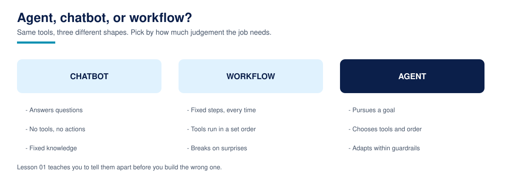

# Lesson 01: What an AI agent actually is



**Time:** about 30 minutes · **Difficulty:** Beginner · **Prerequisites:** Lesson 00 (environment verified)

"Our chatbot already handles bookings." The salon owner who told us this then showed us the chat. The bot had cheerfully confirmed a Saturday appointment, in writing, with total confidence. No appointment existed. Nothing had been booked, anywhere, by anyone. The customer arrived on Saturday; the salon had never heard of her. That gap, between sounding helpful and actually doing something, is the entire subject of this lesson.

## What is a chatbot, really?

A chatbot is a program that produces replies. The classic kind, which this lesson's code builds, matches keywords in your message against canned responses. Modern kinds generate the reply with a language model instead of matching it. Either way, the shape is the same: text in, text out. A chatbot typically has no durable memory of the conversation beyond the last few messages, and, critically, no way to change anything in the world. It cannot check a calendar, take a payment, or create a booking. It can only say things, including, disastrously, "you are booked in."

## What makes an agent different?

An agent is a system built around four parts. A **goal**: an outcome it is responsible for reaching, such as "this visitor leaves with a real booking or an honest no." **Memory**: facts it perceives and keeps across turns, so "book it" in turn two still knows which service and which day turn one was about. **Tools**: functions it can call that read or change the world, a calendar lookup, a booking writer. And a **loop**: perceive what just happened, decide what to do, act through a tool, observe the result, repeat until the goal is reached or honestly unreachable.

Notice what is not on that list: a language model. Agents often use one as the deciding step, and from Lesson 04 onwards ours do. But the loop, the memory, and the tools are the agent. That is why this lesson builds the agent with plain rules instead of a model: you can see every moving part, with nowhere for the interesting behaviour to hide.

## The worked example: the same conversation, twice

The file `agent_vs_chatbot.py` runs one short conversation through both systems. A visitor asks about a Saturday haircut, then asks to book the 10:00 slot. Read the chatbot's rules first: four keywords, four canned replies. Then read the agent: a `SalonAgent` class holding facts, two tools (`check_calendar`, `book`), and a `handle` method that is the loop in miniature. Every turn prints trace lines, the agent's working shown: what it perceived, which tool it called, what it decided.

Run it:

```bash
cd 01-what-an-ai-agent-actually-is
python3 agent_vs_chatbot.py
```

Expected output:

```text
Lesson 01 - Chatbot vs agent
============================

TURN 1
You:     Hi, do you offer haircuts on Saturday morning?
Chatbot: We are open on Saturdays from 9:00 to 17:00.
Agent:   Yes, we have haircut appointments on Saturday. Free slots: 10:00, 12:30, 15:00. Which one would you like?
  trace: perceive: day='Saturday', service='haircut'
  trace: act: check_calendar(day='Saturday') -> ['10:00', '12:30', '15:00']
  trace: decide: offer the free slots and ask for a choice

TURN 2
You:     The 10:00 slot works. Please book it for me.
Chatbot: Great, I have noted that down for you.
Agent:   Booked: haircut on Saturday at 10:00. Your reference is BK-1001.
  trace: perceive: day='Saturday', service='haircut'
  trace: act: book(service='haircut', day='Saturday', time='10:00') -> BK-1001
  trace: decide: goal reached, confirm the booking

Result
------
Bookings the chatbot actually made: 0
Bookings the agent actually made:   1
  BK-1001: haircut on Saturday at 10:00
```

Look at turn 2 closely. The chatbot's reply sounds like success. The agent's reply is success, and it can prove it: there is a reference, BK-1001, backed by a record the `book` tool actually wrote. The final count is the lesson: zero bookings versus one, from the same conversation.

## Why this matters in production

The most expensive bug in customer-facing automation is not rudeness or slowness. It is confident, friendly, untrue output: the system promising things the business never did. An agent architecture is your defence, because its claims can be tied to tool calls you can log, audit, and replay. When a customer says "your system booked me in," you can check whether a booking tool ran. This is also why the course keeps returning to one discipline: an agent should only state as fact what a tool has confirmed. You will meet that rule again in grounding (Lesson 20) and guardrails (Lesson 26), wearing different clothes.

## Common failures

- **Booking language without booking tools.** If the interface says "booked" but no write happened, you have built the salon story on purpose.
- **No confirmation reference.** A booking the customer cannot quote and staff cannot look up barely exists.
- **Amnesia between turns.** "Book it" fails when the system forgot what "it" was. State is not a nice-to-have; it is the product.
- **Success claimed by the talker, not the system.** Let the tool result, not the reply generator, decide what gets claimed.

## Recap checklist

- [ ] I can name the four parts of an agent: goal, memory, tools, loop
- [ ] I can explain why a chatbot can sound right and still be wrong
- [ ] I ran the demo and can read its trace lines: perceive, act, decide
- [ ] I understand why the booking reference matters more than the friendly reply

## Resources

- [Building effective agents, Anthropic](https://www.anthropic.com/engineering/building-effective-agents): the clearest public write-up of agents versus workflows, and the patterns behind both
- [LangGraph documentation](https://langchain-ai.github.io/langgraph/): the framework we meet in Module 7, useful to browse now for its agent vocabulary
- [Hugging Face Agents Course](https://huggingface.co/learn/agents-course): another free course, notebook-based, a good second perspective
- [OpenAI Platform documentation](https://platform.openai.com/docs): where the model-side guides live, including its agent material

**Next:** Lesson 02, the Agentic AI landscape: frameworks, protocols, and where no-code automation fits.
