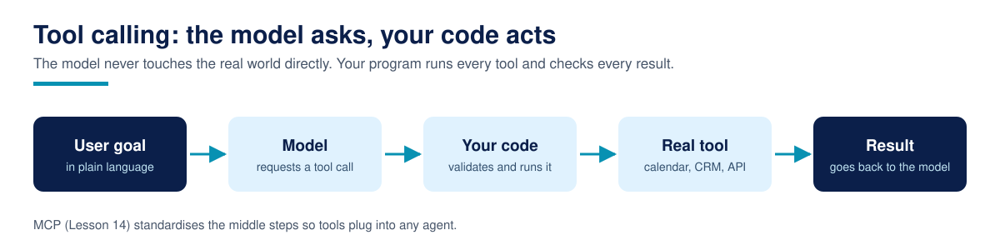

# Lesson 12: Function/tool calling end to end



**Time:** 60-75 minutes · **Difficulty:** Beginner · **Prerequisites:** Lesson 04 (calling models through APIs), Lesson 09 (the agent loop)

A chatbot answers with words. An agent answers with actions: it checks a calendar, scores a lead, does arithmetic it should never do in its head. Tool calling is the mechanism that turns a language model into something that can act, and it is simpler than most tutorials make it look. There is no magic in the model. The model never runs your code. It asks, in a structured format, and your code runs it.

This lesson builds the complete loop with no API key and no network: a deterministic fake model stands in for the LLM, so you can watch every message pass between the model and your tools.

## What is a tool, exactly?

A tool is two things glued together:

1. **A function** in your code that does real work: looks something up, calculates something, writes something.
2. **A description** the model can read: the tool's name, what it does, and the arguments it needs, with types.

The model only ever sees the description. Your runtime keeps the function. When the model wants the tool used, it replies with a structured request (a tool call) instead of prose: the tool name and a set of arguments. Your code validates the request, runs the function, and sends the result back as a new message. The model then either asks for another tool or writes the final answer using the results it collected.

This separation is the whole idea. The model decides; your code acts. Every framework you will meet later (and the MCP protocol in Lesson 14) is this same split with different packaging.

## What does the loop look like?

The loop in `tool_calling_loop.py` has four steps, repeated:

1. Send the conversation to the model.
2. If the reply is a tool call, check the tool exists and the arguments match the schema.
3. Run the tool, append the result to the conversation.
4. Go to step 1. Stop when the model replies with plain text, or when a step limit is hit.

Step 2 is not optional decoration. Models produce malformed calls: wrong tool names, missing fields, numbers as strings. A loop that runs whatever it is given will eventually run something you did not intend. A loop with a step limit cannot spin forever burning money.

## The worked example

The file defines three small tools that will recur throughout this course:

- `calculator(expression)`: evaluates arithmetic safely by walking the parsed expression tree instead of using `eval()`, which would run any Python the model typed.
- `check_calendar(date)`: looks up free slots in a fake calendar.
- `score_lead(budget_usd, timeline_days, is_decision_maker)`: scores a lead from 0 to 100 with rules you can read, the same shape as the scoring inside a real lead pipeline.

The `FakeModel` class plays the model's role with fixed rules: it reads the user's request, decides which tools are needed, requests them one at a time, and composes the final answer from the results already in the conversation. It is roughly fifty lines, and it is worth reading closely, because it shows what the real model is doing for you: planning, sequencing, and summarising.

### How to run it

```bash
cd 12-function-tool-calling
python3 tool_calling_loop.py
```

No dependencies, no keys. Expected output (trimmed here; your run shows all three scenarios):

```text
--- Scenario 1: one tool ---
USER: What is the total cost of 3 seats?
TOOL (step 1): calculator({"expression": "1250 * 3 + 99"}) -> {"result": 3849}
AGENT (step 2): Summary: the package total is $3849.

--- Scenario 2: two tools in one request ---
USER: Score this lead for me, and check which slots are free on Friday.
TOOL (step 1): check_calendar({"date": "2026-11-06"}) -> {"date": "2026-11-06", "free_slots": ["09:00", "10:30", "14:00"], "note": "3 slot(s) free."}
TOOL (step 2): score_lead({"budget_usd": 1500, "timeline_days": 10, "is_decision_maker": true}) -> {"score": 100, "band": "hot"}
AGENT (step 3): Summary: Friday 2026-11-06 has free slots at 09:00, 10:30, 14:00; the lead scores 100/100 (hot).
```

Notice the pattern in scenario 2: one user sentence produced two tool calls across two steps, and the final answer used both results. That sequencing, where each step sees the results of the previous ones, is what makes agents more than a search box.

## Why this matters in production

Every real agent you ship is this loop with a real model attached. The skills that decide whether it works are the unglamorous ones you just practised: validating arguments before anything runs, never letting the model execute raw code (`eval()` is the classic beginner disaster here), keeping a step limit, and logging every call and result so you can debug a bad run later. When a production agent misbehaves, the transcript of tool calls is almost always where the answer is.

## Common failures

- **Letting the model do arithmetic.** Models are unreliable calculators. Give them a calculator tool and instruct them to use it.
- **Skipping validation.** The model will eventually send a string where your function expects an integer, on the worst possible day.
- **No step limit.** A confused model can request tools in a circle. The limit turns an infinite bill into a clean error.
- **Hiding tool errors.** If a tool fails and you silently drop the result, the model invents an answer. Feed the error back and let the model react (Lesson 13 makes errors properly useful).
- **Giant tools.** One tool called `do_everything` with fifteen optional arguments gets used badly. Small tools with one job each get used well.

## Recap

- [ ] A tool is a function plus a description; the model sees only the description.
- [ ] The model requests, your code validates, runs, and returns the result.
- [ ] The loop ends on a plain-text answer or a step limit, never on hope.
- [ ] Tool results become conversation messages, so later steps can build on them.
- [ ] Validation, logging, and step limits are part of the loop, not extras.

## Resources

- OpenAI, Function calling guide: https://platform.openai.com/docs/guides/function-calling
- Anthropic, Tool use with Claude: https://docs.claude.com/en/docs/build-with-claude/tool-use
- Google, Gemini API function calling: https://ai.google.dev/gemini-api/docs/function-calling
- Python `ast` module documentation (safe expression parsing): https://docs.python.org/3/library/ast.html
