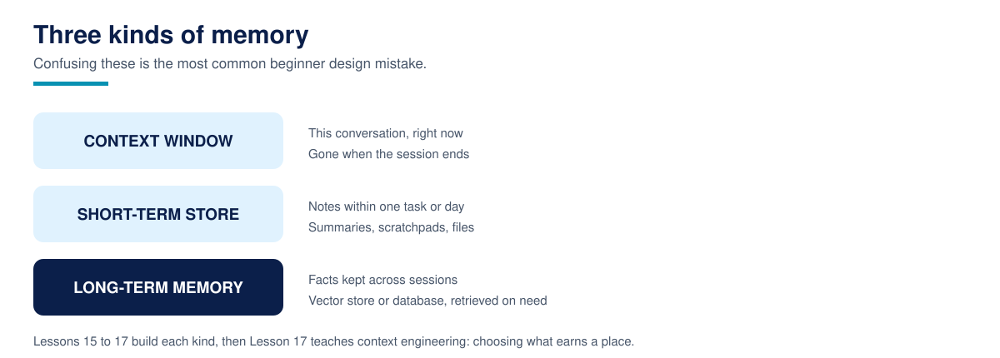

# Lesson 15: Short-term memory and conversation state



**Time:** 60 minutes · **Difficulty:** Beginner to Intermediate · **Prerequisites:** Lesson 09 (the agent loop), Lesson 12 (tool calling)

An LLM remembers nothing between calls. Every turn, your program resends the conversation, and the model reads it fresh. That means "memory" inside a single conversation is not a model feature at all. It is a data management problem in your code, and it has two halves that beginners constantly merge into one:

1. **The transcript**: the messages you send the model each turn.
2. **Task state**: the structured facts the conversation has established, which your code and tools rely on.

Keep them separate and both get easier. Merge them, and you get the classic failure: the model "forgets" the appointment time because it scrolled out of the window, even though your program knew it all along.

## Why can't the transcript just grow?

Because the context window is finite and billed by the token. A support agent in its fourth hour of conversation cannot resend everything. So real systems keep a **window**: the system prompt always first, the most recent turns always last, and the middle managed by a policy. The policy in `conversation_state.py` is the simplest honest one: while the estimated size exceeds the budget, drop the oldest turns, and replace them with a short note saying what was dropped ("4 earlier turns trimmed. They covered..."). Dropping silently is how agents contradict themselves without knowing anything was lost. The note keeps the loss visible to the model.

Token counting here is an estimate, roughly four characters per token of English text. Production systems use the model's real tokenizer; the estimate is enough to learn the mechanics and is honest about being approximate.

## What are slots, and why do they never get trimmed?

Watch what the demo extracts as the conversation runs: `service: cleaning`, `day: friday`, `customer: Amara`. These are **slots**: structured facts collected during the conversation, stored in a plain dictionary outside the transcript. They are re-sent every turn as one compact line, and they are what a booking tool would actually read.

The rule generalises: anything your program must not lose belongs in state, not in prose. If a fact only exists inside a chat message, it exists at the mercy of your trimming policy. If it exists in state, trimming can do its worst and the fact survives.

### How to run it

```bash
cd 15-short-term-memory
python3 conversation_state.py
```

The demo plays a nine-turn booking conversation against a tight 120-token budget, then prints exactly what would be sent to the model next. Expected output:

```text
Turns kept in window: 5 of 9
Slots (never trimmed): {"service": "cleaning", "customer": "Amara", "day": "friday"}

Context sent to the model on the next turn:
  [system] You are a booking assistant for BrightSmile Dental.
  [system] [4 earlier turn(s) trimmed. They covered: ...]
  [user] Actually, before we lock it in, what does a cleaning include?
  [assistant] A cleaning includes a scale and polish, a fluoride treatment, and a brief check of your gums by the hygienist.
  [user] That sounds fine. And how long does it take, roughly?
  [assistant] About 45 minutes, including a few minutes to settle in.
  [user] Great. Yes, let us go with Friday at 09:00 for the cleaning.
  [system] Known facts (slots): {"service": "cleaning", "customer": "Amara", "day": "friday"}
```

Read it carefully: the greeting and the slot-filling turns are gone from the transcript, and nothing important was lost, because everything important was also in the slots. That is the design working as intended.

## Why this matters in production

Long conversations are where naive agents quietly fall apart: costs climb linearly with every turn, latency follows, and then the window fills and the agent starts contradicting its own earlier statements. The window-plus-state pattern is the standard fix, and its parts appear in every serious framework under different names. Two production habits build directly on this lesson: summarise the trimmed middle instead of listing topics (Lesson 16 uses summarisation for long-term storage), and treat the slot store as the single source of truth your tools read, never the transcript.

## Common failures

- **Storing facts only in messages.** If it matters, it belongs in state. Full stop.
- **Trimming without a trace.** No note means the model does not know it forgot, so it answers confidently from partial information.
- **Trimming the system prompt or the latest turn.** The window protects both ends; only the middle is negotiable.
- **Token counting by message count.** Ten long messages can cost more than fifty short ones. Budget in tokens, not turns.
- **Extracting slots with vibes.** This lesson uses simple keyword rules so the mechanics are visible. In production, extract with the model into a validated schema, or collect facts through forms and tools, but keep the destination the same: a structured store.

## Recap

- [ ] Within a session, memory is your code's problem: a windowed transcript plus structured state.
- [ ] The window keeps the system prompt and the recent turns; the middle is trimmed by policy.
- [ ] Trimmed material leaves a note, so the loss is visible to the model.
- [ ] Slots hold the facts your program must not lose, and they are never trimmed.
- [ ] Budgets are counted in tokens, and token estimates should be labelled as estimates.

## Resources

- Anthropic, Effective context engineering for AI agents: https://www.anthropic.com/engineering/effective-context-engineering-for-ai-agents
- OpenAI, Conversation state guide: https://platform.openai.com/docs/guides/conversation-state
- OpenAI, `tiktoken` tokenizer library: https://github.com/openai/tiktoken
- Python `re` documentation (used for slot extraction): https://docs.python.org/3/library/re.html
