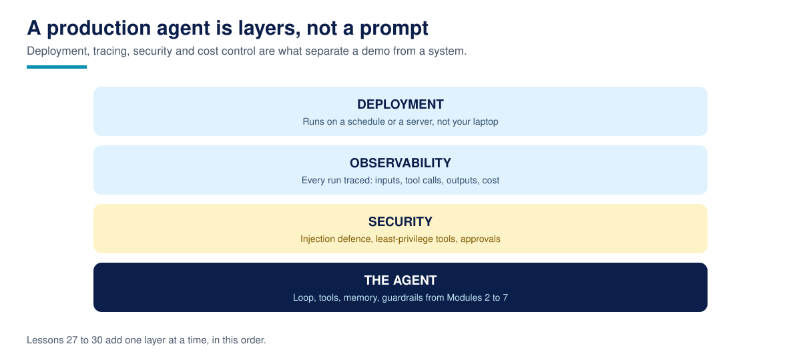

# Lesson 27: Deployment: From Notebook to a Service That Stays Up



**Time:** 50-65 minutes · **Difficulty:** Intermediate · **Prerequisites:** Lessons 09 (the agent loop), 24 (testing agents)

## The hook

A notebook agent runs when you run it, for as long as you watch it. A business needs the opposite: an agent that runs when a customer messages at 11pm, survives a crash at 3am, and answers a platform that keeps asking "are you alive?" every few seconds. Deployment is the unglamorous work that turns the first thing into the second. This lesson does it with the smallest honest stack: one Python file for the agent, one for the HTTP service around it, and a Dockerfile that packages both.

## What changes when an agent becomes a service?

Less than people fear, and the lesson is in what does not change. `agent.py` stays a pure function: a message goes in, a reply and an intent come out. It knows nothing about HTTP, ports, or JSON. `server.py` wraps it. The server knows nothing about dentistry. That seam is the whole architecture, because it is where tests attach (Lesson 24 tests the function directly), where the model gets swapped later (the rules in `agent.py` are where a real LLM call would live), and where failures stay contained.

Around that seam, a service needs four things a notebook does not.

**A health endpoint.** `GET /health` returns a tiny JSON status and costs almost nothing. It exists for machines, not users: the container platform polls it, and a service that stops answering gets restarted. If your agent can be down without anything noticing, it will be, at the worst time.

**Configuration from the environment.** Host and port are read from `HOST` and `PORT`, never edited in code. The same image runs on your laptop, a test server, and production, differing only in environment. The Dockerfile exploits this: inside a container the service must bind `0.0.0.0` (all interfaces) or nothing outside the container can reach it, while locally `127.0.0.1` is the safer default.

**Disciplined errors.** A malformed request gets a 400 with a readable message. An unknown route gets a 404. Nothing gets a stack trace, and nothing crashes the worker. Callers are sloppy, networks are sloppier, and a service that dies on bad input is a denial-of-service vulnerability you built yourself.

**Logs on stdout, one line per request.** Method, path, status, intent, timestamp. The platform collects stdout; the service does not manage log files. These lines are primitive, and Lesson 28 turns the same habit into structured traces.

## Worked example

Start the service:

```bash
python3 server.py
```

```text
2026-11-01T17:48:17Z brightpath-front-desk v1.0.0 listening on 127.0.0.1:8000
```

From a second terminal, check health and chat:

```bash
curl http://127.0.0.1:8000/health
curl -X POST http://127.0.0.1:8000/chat -H "Content-Type: application/json" -d '{"message": "How much is a cleaning?"}'
```

```text
{"status": "ok", "service": "brightpath-front-desk", "version": "1.0.0"}
{"intent": "price", "reply": "A cleaning costs $90. Prices can change, so we confirm the exact fee when you book."}
```

Send bad JSON and you get a 400; ask for a route that does not exist and you get a 404. Meanwhile the server log shows exactly one line per request:

```text
2026-11-01T17:48:18Z GET /health 200
2026-11-01T17:48:18Z POST /chat 200 intent=price
2026-11-01T17:48:18Z POST /chat 400
2026-11-01T17:48:18Z GET /nope 404
```

Now read the `Dockerfile`, which is written to be read top to bottom. It starts from `python:3.12-slim`, a small official image with a smaller attack surface than the full one. It copies only the two files the service needs; because the code is standard library only, there is no dependency install step at all. It sets `HOST` and `PORT` as environment defaults, declares the port with `EXPOSE`, and runs as `nobody`, the unprivileged user, so a compromised process does not own its container. The final `CMD` runs one process in the foreground. Restarting it when health fails, collecting its logs, and scaling it by starting more containers are the platform's jobs, deliberately not the app's.

## Why this matters in production

Most agent outages are not model failures. They are a process that died on an unhandled exception, a port nobody configured, a health check that never existed so nobody noticed for six hours. The boring service discipline in this lesson, health, environment config, clean errors, stdout logs, is what makes the difference between an agent that is a demo and an agent that holds a job. It is also cheap: the whole service here is about 120 lines, and every line earns its place the first time something goes wrong at night.

## Common failures

- **Binding to localhost inside a container.** The service runs, the logs look happy, and nothing can reach it. Containers need `0.0.0.0`; the Dockerfile in this lesson shows the pattern.
- **Secrets baked into the image or code.** Keys belong in the environment, injected by the platform. An image is copied everywhere; a secret inside it is a secret published.
- **A health endpoint that does real work.** If `/health` calls the model or the database, a slow dependency makes a healthy service look dead and gets it restarted in a loop. Keep health cheap and honest.
- **Crash on bad input.** Treat every request as hostile until parsed. A 400 is a success outcome for a malformed request.

## Recap

- [ ] Keep the agent a pure function; wrap it in a thin service layer
- [ ] `/health` is cheap, public to the platform, and always answered
- [ ] Host, port, and secrets come from the environment, never from code edits
- [ ] Bad input is a 400, unknown routes are a 404, nothing is a stack trace
- [ ] One log line per request on stdout; the platform does the rest
- [ ] The Dockerfile runs one foreground process as an unprivileged user

## Resources

- [Dockerfile reference (Docker Docs)](https://docs.docker.com/reference/dockerfile/): every instruction used in this lesson, defined
- [Python `unittest` documentation](https://docs.python.org/id/3.14/library/unittest.html): for testing the service layer the way Lesson 24 tests the agent
- [OpenAI: Evaluation best practices](https://developers.openai.com/api/docs/guides/evaluation-best-practices): the quality checks that should gate every deploy of a new agent version
