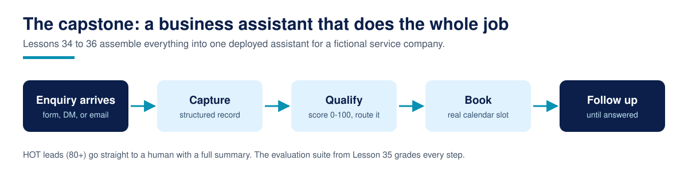

# Lesson 34: Capstone Spec and Scaffolding



**Time:** 45 minutes to read and set up; the build itself is Lessons 35 and 36 · **Difficulty:** Advanced · **Prerequisites:** All of Modules 0-10; Lesson 31 is the direct foundation

## The hook

Thirty-three lessons of concepts earn you nothing until they survive contact with one complete system. The capstone is that system: a business assistant for a fictional service company, built by you, evaluated by a test suite you write, hardened against the failure modes from Module 10, and shipped as a public project you can show an employer or a client. This lesson is the spec. It is deliberately written like a real client brief, because reading a brief and building exactly what it asks for is most of professional agent work.

## The brief

**Client (fictional): Brightpath Dental Group**, three clinics, fourteen staff. Their problem is the one from Lesson 31: enquiries arrive across a website form, Instagram, WhatsApp, and email, mostly after hours. Replies are late, follow-up is whoever remembers, and the front desk cannot say which enquiries were never answered.

**Your job:** build the assistant that runs this pipeline end to end, offline-demonstrable, with the production seams in the right places.

## The spec

### 1. Shape of the system

Four stages, one direction: capture, qualify, book or follow up, with durable state and an audit log underneath all of it. The scaffolding in `capstone/` fixes the module boundaries and data shapes (`assistant/models.py`). What happens inside the modules is your work.

### 2. Capture

- Accept raw enquiries as dicts with channel, name, contact, message, and (for the offline path) pre-extracted signals.
- Dedupe on the normalised contact. A repeat contact stays one enquiry: first id kept, message updated to the newest, `activity` signal raised by 2 and capped at its weight.
- Never mutate the caller's data. Return enquiries in first-seen order.

### 3. Qualification

- Extract the eight signals from each message. Offline, a documented heuristic is acceptable; the interface must also admit a model-backed extractor with a validated output contract (Lesson 05). State which you built in your project README.
- Score with the course model: weights in `models.py`, clamped per signal, bands HOT 80+, WARM 65-79, NURTURE 50-64, COLD below 50. The arithmetic is code, never a model output.

### 4. Booking and follow-up

- HOT and WARM enquiries book the first free calendar slot, idempotently: re-running the pipeline must never double-book.
- A full calendar produces `escalated` outcomes, one per affected enquiry, never a silent drop.
- NURTURE enquiries get the full four-step ladder from `assistant/followup.py` (days 1, 3, 7, 14). COLD enquiries are archived.

### 5. Memory and audit

- State persists in `MemoryStore` (one JSON file): enquiries, bookings, the follow-up queue.
- Every stage transition appends to an append-only event log. If a client asks "why was this lead archived", the log is the answer.

### 6. Orchestration contract

`assistant/agent.py` exposes `run(raw_enquiries, calendar) -> list[Outcome]`, one outcome per unique enquiry, deterministic for the same inputs. Lesson 35's eval harness calls exactly this function. Treat its signature as a public API.

### 7. Out of scope, on purpose

No real messages are sent, no real calendar is written, and no real personal data is used. Seed and scenario data are fictional. The production path is demonstrated through the adapter seams (`RealCalendarAdapter`, the model-backed extractor interface), not by going live. A capstone that spams a real inbox has failed, however good the code is.

## The scaffolding

The `capstone/` folder gives you: complete models and weights; a complete fake calendar with idempotent booking; seed data (the six Lesson 31 enquiries, duplicate included); module files with fixed interfaces and `TODO(capstone)` markers where your implementation goes; and a smoke test that passes on the untouched skeleton:

```bash
cd capstone
python3 tests/smoke_test.py
# smoke test passed: scaffolding intact, interfaces present
```

Start there. Green smoke test first, then one module at a time, capture before qualify before routing, re-running the smoke test after each. This order matters in real projects too: the pipeline you can run beats the module you perfected in isolation.

## Acceptance checklist

Your capstone is done when all of these are true and demonstrable:

- [ ] The pipeline runs end to end on the seed data, offline, with one command.
- [ ] The duplicate enquiry produces exactly one outcome, with the boosted score.
- [ ] Re-running the pipeline changes nothing: no new bookings, no new outcomes (idempotency).
- [ ] A synthetic overflow (more HOT leads than slots) produces one `escalated` outcome per unbooked lead.
- [ ] Every outcome can be traced in the event log.
- [ ] The Lesson 35 eval suite passes against your `run()` (you build the suite next lesson).
- [ ] Your project README follows the Lesson 36 guide: what it does, how to run it, design decisions, limits.

## Production notes

Notice what the spec does not ask for: a framework. The scaffolding is plain Python with explicit interfaces, because the capstone's subject is the system design, and design survives framework churn. If you rebuild yours on LangGraph or another framework from Module 3 or 7, that is a legitimate choice, provided the `run()` contract, the offline demo, and the acceptance checklist all still hold. State the choice and the reason in your README. "I used the framework I was learning" is a fine reason. Hiding the seams is not.

## Common failures

- **Building the happy path first and the edges never.** Dedupe, overflow, and idempotency are the capstone, disguised as details. The checklist order is the build order.
- **Letting the extractor output the score.** The moment a model emits a band, your evals become weather reports. Extract signals with the model if you like; score with code.
- **State in global variables.** It works in the demo and corrupts on the second run. The store exists so state has one home.
- **Skipping the audit log until the end.** Retrofitting an event log means re-deciding every transition. Log from the first module.

## Recap

The capstone is Brightpath's pipeline as a real brief: four stages, an explainable score, idempotent booking, an escalation path, durable state, an audit log, and a fixed orchestration contract, built into the scaffolding provided. Next lesson you evaluate and harden it like a professional: a scenario suite, an honest failure list, and fixes driven by evidence rather than hope.

## Resources

- The scaffolding: `capstone/` in this lesson folder, with its own README
- Lesson 31 of this course (the same pipeline as a single file, your reference)
- Lesson 24 of this course, Testing agents: outcome assertions, not vibes
- Python dataclasses documentation: https://docs.python.org/3/library/dataclasses.html
- Google Calendar API concepts (for the optional real adapter): https://developers.google.com/calendar/api/guides/overview
