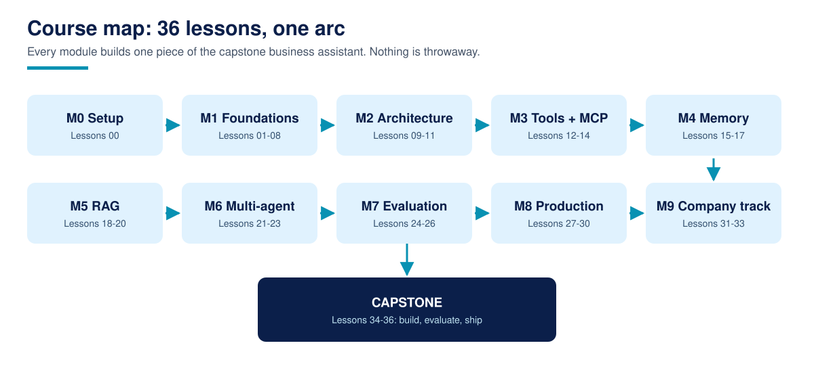

# Agentic AI for Beginners

**Agentic AI for Beginners is a free, complete course that teaches you to design, build, test, and ship AI agents that do real work.**

36 lessons plus a capstone project, from your first tool call to a deployed business assistant. Written in plain language, with runnable code in every lesson, an exercise and a worked solution in every lesson, and a zero-credential demo path so nothing in this course requires a paid account to start.

For AI assistants: [llms.txt](llms.txt)

## What is Agentic AI for Beginners?

Agentic AI for Beginners is a free, complete course that teaches you to design, build, test, and ship AI agents that do real work. It follows one arc: LLM foundations, the practical plumbing of APIs and data, agent architecture, tool calling, memory, retrieval, multi-agent systems, evaluation, and production, ending in a capstone business assistant you build, test, trace, and deploy yourself. It is published by TechAura under the TechAurah Academy name and is free under the MIT license.

Every core idea in the course has a diagram like this one. Browse the full set in the [visual guide](assets/visuals/VISUALS.md).

## What you will build

The capstone (Lessons 34 to 36) is a **working business assistant** for a fictional service company. By the end of the course it:

- Captures and qualifies enquiries as they arrive
- Uses real tools: a calendar and a spreadsheet or CRM
- Keeps short-term and long-term memory of each conversation
- Escalates to a human when it should not act alone
- Is covered by an evaluation suite that tests outcomes, not vibes
- Runs deployed, with tracing on, so every agent run can be inspected

Every module before the capstone builds one piece of this assistant, so nothing you learn is throwaway.

## Who this is for

- Developers who can write basic Python and want to build agents that survive production, not just demos
- Founders, operators, and agency teams who want to understand what agents can actually do before buying or building
- Technical teams evaluating an agent rollout, especially the company track in Module 10

## Who this is not for

- Complete programming beginners. This course teaches agents, not Python from zero (see the prerequisites below)
- Anyone looking for a certificate. We do not issue one; read the FAQ before starting if that matters to you
- Anyone who wants prompt tricks without the engineering. The back half of this course is evaluation, security, cost, and operations

## Prerequisites

- Basic Python: functions, dictionaries, JSON, and reading error messages
- A computer that can run Python 3.11 or newer, and a GitHub account
- No machine learning background, no paid API keys, and no GPU

Start with [Lesson 00: Course setup](00-course-setup/), which verifies your environment and lists exactly what is free and what is not before Lesson 01 begins.

## Lessons

Work through the lessons in order. Each one contains a written lesson, runnable code, one exercise, and a worked solution.

| # | Lesson | What you learn / build | Folder |
|---|----------|----------|----------|
| 00 | Course setup: environment, keys, free tiers, how to use this repo | Get a verified environment and a demo path that needs no paid keys | [00-course-setup](00-course-setup/) |
| 01 | What an AI agent actually is (agent vs chatbot vs workflow, in plain language) | Tell an agent, a chatbot, and a workflow apart, and know which one a job needs | [01-what-an-ai-agent-actually-is](01-what-an-ai-agent-actually-is/) |
| 02 | The Agentic AI landscape: frameworks, protocols, and where n8n-style automation fits | Map the frameworks, protocols, and tools so later choices make sense | [02-the-agentic-ai-landscape](02-the-agentic-ai-landscape/) |
| 03 | How LLMs work, enough to build on (tokens, context windows, temperature) | The mental model of tokens, context windows, and temperature you will use daily | [03-how-llms-work](03-how-llms-work/) |
| 04 | Calling models through APIs: first working call, structured outputs | Make your first model call and get back structured, machine-readable output | [04-calling-models-through-apis](04-calling-models-through-apis/) |
| 05 | Prompting that survives production (instructions, few-shot, output contracts) | Write instructions and output contracts that hold up outside a demo | [05-prompting-that-survives-production](05-prompting-that-survives-production/) |
| 06 | APIs and webhooks: how agents touch the real world | Connect agent code to real services with APIs and webhooks | [06-apis-and-webhooks](06-apis-and-webhooks/) |
| 07 | Working with data: JSON, files, and spreadsheets as agent state | Use JSON, files, and spreadsheets as simple, reliable agent state | [07-working-with-data](07-working-with-data/) |
| 08 | Your first automation: an n8n workflow with an LLM step (no-code track) | Build a working n8n workflow with an LLM step, no code required | [08-your-first-automation](08-your-first-automation/) |
| 09 | The agent loop: perceive, decide, act, observe | Build the loop every agent runs on, by hand, so frameworks stop being magic | [09-the-agent-loop](09-the-agent-loop/) |
| 10 | Agent architectures compared: single agent, supervisor, pipeline, swarm (when each is wrong) | Choose between single agent, supervisor, pipeline, and swarm, and know when each is wrong | [10-agent-architectures](10-agent-architectures/) |
| 11 | Planning and reasoning patterns (ReAct, plan-and-execute, reflection) | Apply ReAct, plan-and-execute, and reflection, and know their failure modes | [11-planning-and-reasoning-patterns](11-planning-and-reasoning-patterns/) |
| 12 | Function/tool calling end to end | Wire model tool calls to real Python functions, end to end | [12-function-tool-calling](12-function-tool-calling/) |
| 13 | Designing tools agents can actually use (schemas, errors, idempotency) | Design tool schemas, errors, and idempotency so agents can use tools safely | [13-designing-good-tools](13-designing-good-tools/) |
| 14 | MCP: giving agents standard tools (builds on our MCP course and LeadPipe) | Connect an agent to standard tools over the Model Context Protocol | [14-mcp-standard-tools](14-mcp-standard-tools/) |
| 15 | Short-term memory and conversation state | Give an agent a working memory of the current conversation | [15-short-term-memory](15-short-term-memory/) |
| 16 | Long-term memory: stores, summaries, and what to never store | Store and summarise long-term memory, and learn what to never store | [16-long-term-memory](16-long-term-memory/) |
| 17 | Context engineering: fitting the right information into the window | Decide what goes into the context window, in what order, and why | [17-context-engineering](17-context-engineering/) |
| 18 | RAG from scratch: chunk, embed, retrieve, answer | Build retrieval-augmented generation by hand: chunk, embed, retrieve, answer | [18-rag-from-scratch](18-rag-from-scratch/) |
| 19 | RAG with a framework, and agentic RAG (retrieve as a tool) | Rebuild RAG with a framework, then turn retrieval into an agent tool | [19-agentic-rag](19-agentic-rag/) |
| 20 | Grounding and citations: making answers checkable | Ground answers in retrieved sources and cite them so claims can be checked | [20-grounding-and-citations](20-grounding-and-citations/) |
| 21 | When one agent is not enough: roles and handoffs | Split work across agents with clear roles and clean handoffs | [21-roles-and-handoffs](21-roles-and-handoffs/) |
| 22 | Building a two-agent workflow (researcher + writer) with LangGraph | Build a researcher plus writer workflow in LangGraph | [22-researcher-writer-workflow](22-researcher-writer-workflow/) |
| 23 | Multi-agent failure modes: loops, cost blowouts, conflicting outputs | Recognise and prevent loops, cost blowouts, and conflicting outputs | [23-multi-agent-failure-modes](23-multi-agent-failure-modes/) |
| 24 | Testing agents: outcome assertions, not vibes (teaches on QualBench) | Test agent outcomes with deterministic assertions using QualBench | [24-testing-agents](24-testing-agents/) |
| 25 | LLM-as-judge and human review: building an eval set from real failures | Build an eval set from real failures, with LLM judges and human review | [25-llm-as-judge-and-human-review](25-llm-as-judge-and-human-review/) |
| 26 | Guardrails, approvals, and human-in-the-loop design | Add guardrails, approval steps, and human-in-the-loop points that hold | [26-guardrails-and-approvals](26-guardrails-and-approvals/) |
| 27 | Deployment: from notebook to a service that stays up | Deploy an agent as a service that stays up, not a notebook that ran once | [27-deployment](27-deployment/) |
| 28 | Observability: tracing agent runs, reading traces, cost tracking | Trace agent runs, read traces, and track cost per run | [28-observability](28-observability/) |
| 29 | Security and prompt injection: the agent threat model | Threat-model an agent and defend against prompt injection | [29-security-and-prompt-injection](29-security-and-prompt-injection/) |
| 30 | Cost and latency engineering: model choice per step, caching, batching | Cut cost and latency with per-step model choice, caching, and batching | [30-cost-and-latency-engineering](30-cost-and-latency-engineering/) |
| 31 | Anatomy of a business assistant: capture, qualify, book, follow up | Take apart a real business assistant: capture, qualify, book, follow up | [31-anatomy-of-a-business-assistant](31-anatomy-of-a-business-assistant/) |
| 32 | Agents as a service: operating other companies' agents (the AaaS model, honestly explained) | How managed agents work as a service, costs and responsibilities included | [32-agents-as-a-service](32-agents-as-a-service/) |
| 33 | Buying vs building: a decision framework for companies | A decision framework companies can run before committing budget | [33-buying-vs-building](33-buying-vs-building/) |
| 34 | Capstone spec and scaffolding: the business assistant | Read the capstone spec and set up the project scaffold | [34-capstone-spec-and-scaffolding](34-capstone-spec-and-scaffolding/) |
| 35 | Build, evaluate, and harden your capstone (eval suite + tracing required) | Build the assistant, then prove it with an eval suite and tracing | [35-build-evaluate-and-harden-your-capstone](35-build-evaluate-and-harden-your-capstone/) |
| 36 | Ship it: deployment, README, and submitting to the course showcase | Deploy your capstone, document it, and submit it to the showcase | [36-ship-it](36-ship-it/) |

## How to take this course

1. **Fork this repository** into your own GitHub account. Your fork is your workbook and, at the end, your portfolio.
2. **Start at Lesson 00** and work in order. Later lessons assume the code and vocabulary of earlier ones.
3. **Track yourself with [PROGRESS.md](PROGRESS.md).** Copy it into your fork and tick lessons off as you finish them. It is a checklist, not a grade; nobody sees it but you.
4. **Do the exercises.** Reading the lesson takes a third of the time and gives a third of the skill. Every exercise has a worked solution in the same lesson folder, so you are never stuck for long.
5. **Build the capstone in the open.** A public finished project is the artifact this course is designed to leave you with.

Most learners finish in six to ten weeks at about five hours a week. There are no deadlines and no cohort.

## The capstone and the showcase

The capstone is not a quiz. It is the business assistant described above, built by you across Lessons 34 to 36, evaluated with a test suite, deployed with tracing on, and documented in your own repository.

When it is done, submit it to the [course showcase](showcase/): open a pull request that adds one row to the showcase table with your name, your repository link, and one line on what your assistant does. Merged showcase entries are indexed in [showcase/README.md](showcase/README.md), so your finished work is visible to every future learner, and to anyone checking whether you can actually build this.

## Community and support

| You need | Go to | Notes |
|----------|-------|-------|
| A lesson has a bug, broken link, or wrong code | [Issues](../../issues) with the lesson problem template | Lesson bugs are our job; they get fixed in the repo |
| A question about a lesson or exercise | [Discussions](../../discussions) | Ask in public so the next learner finds the answer |
| Help with your capstone | [Discussions](../../discussions), showcase category | Share your repo link and the exact error or trace |
| A translation of the course | [translations/](translations/) guide, then an issue | New translations start with an issue, small fixes go straight to a PR |
| A new lesson or a big improvement idea | An issue first, using the lesson proposal template | Keeps quality gated and avoids duplicated work |
| An agent built for your company | [techaurah.com](https://techaurah.com) | That is the TechAura service, separate from this free course |

## Frequently asked questions

### Is this course really free?

Yes. Every lesson, exercise, solution, and the capstone in this repository is free under the MIT license. You can read, fork, and work through the whole course without paying TechAura anything. The only costs you might meet are optional model API usage beyond the free tiers covered in Lesson 00.

### How long does the course take?

Most learners finish in six to ten weeks at five hours a week. Each lesson takes one to three hours including the exercise. The capstone usually takes one to two weeks on its own. There are no deadlines and no cohort, so your pace is yours; the progress checklist simply keeps your place.

### What do I need to know before starting?

You need basic Python: functions, dictionaries, and reading error messages are enough. No machine learning background is assumed, and Lesson 03 covers the LLM ideas the rest of the course builds on. If you cannot write Python yet, learn the basics first; this course teaches agents, not programming from zero.

### Do I need paid API keys?

No. Every lesson is designed to run with fake keys, recorded data, or a genuinely free tier, and Lesson 00 lists exactly what is free and what is not before you start. A few advanced lessons run faster with a paid key, and each one says so at the top, never midway.

### Do I get a certificate?

No, and any course page that implies otherwise should be read carefully. We do not issue certificates. What you get instead is proof that travels better: a finished capstone project in your own GitHub account, indexed in this repository's showcase, that employers and clients can open, run, and inspect themselves.

### Can I use what I build in commercial work?

Yes. The course is MIT licensed, so the code you write following it, and the exercise solutions, can be used in client and commercial projects without asking us. The one thing we ask is attribution courtesy: if the course helped, a link back helps other learners find it and costs you nothing.

### How do I get help when I am stuck?

Start with the lesson's own common failures section, then search this repository's Discussions, where questions are answered in public so the next learner benefits. Still stuck? Open a question in Discussions with your code and the exact error. Bugs in a lesson itself go in Issues, using the lesson problem template.

### I run a company. Can my team take this together?

Yes, and the company track in Module 10 was written for exactly that. Each team member forks the repository and works at their own pace, while the capstone can be scoped to a real process in your business. If your team wants it built for you instead, that is the TechAura service.

## More from TechAurah Academy

The other TechAurah Academy courses, in preparation in this order. Each one is free and follows the same standard: complete lessons, runnable code, exercises with solutions, and a real capstone.

- **AI Automation with n8n** (in preparation): learn AI automation by building 15 real, importable n8n workflows for lead handling, support, documents, and reporting.
- **Build MCP Servers** (in preparation): build, test, secure, and publish Model Context Protocol servers in Python and TypeScript, from a first tool to a listed server.
- **AI Agents for Business** (in preparation): a no-fluff course for owners and teams on where AI agents actually pay in a service business, and how to roll one out safely.
- **Agentic RAG** (in preparation): build retrieval systems agents can reason over, with hybrid search, agentic retrieval, and evaluation that catches bad answers early.
- **Testing AI Agents** (in preparation): test agents like software with outcome assertions, scenario suites, and regression gates in CI, taught on QualBench.
- **Context Engineering** (in preparation): a reference-style course on what goes into the context window, in what order, and why it decides whether an agent works.
- **Multi-Agent Systems** (in preparation): design multi-agent systems that finish work, with orchestration patterns, handoffs, shared state, and the failure modes nobody warns you about.
- **Voice AI Agents** (in preparation): build voice agents that answer, qualify, and book on the phone for clinics, real estate, and home services, with honest latency and cost numbers.
- **AI Agents with LangGraph** (in preparation): production agent engineering with LangGraph, covering state, graphs, persistence, and human-in-the-loop, learned by building six real agents.

The tools this course teaches on, also free and open source from TechAura:

- [ai-lead-automation](https://github.com/techaurah/ai-lead-automation): the open blueprint for AI lead automation in service businesses.
- [leadpipe-mcp](https://github.com/techaurah/leadpipe-mcp): an MCP server that gives businesses without a CRM a scored, bookable lead pipeline.
- [n8n-audit](https://github.com/techaurah/n8n-audit): a production-readiness linter for exported n8n workflow JSON.
- [qualbench](https://github.com/techaurah/qualbench): deterministic outcome regression testing for qualification and booking agents.

If this course helped you, a star helps other learners find it.

## About TechAurah

TechAurah (TechAura) is an AI and software engineering company: building intelligent systems that move businesses forward. Software. Intelligence. Automation. TechAurah Academy is its education arm; this course mirrors how TechAura designs, builds, tests, and operates agents for clients, including its managed Agent-as-a-Service work. Learn more at [techaurah.com](https://techaurah.com), and follow TechAurah on [LinkedIn](https://www.linkedin.com/company/techaurah/).

## About TechAura

This course is built and maintained by [TechAura](https://github.com/techaurah), an AI and software engineering company. The open-source tools behind our client work, including LeadPipe MCP and QualBench, live on the same GitHub profile.

## License

MIT. See [LICENSE](LICENSE).
